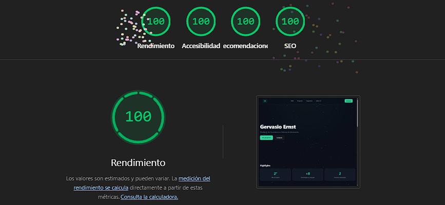
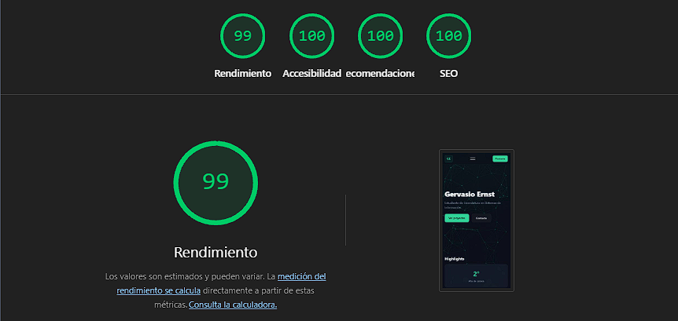
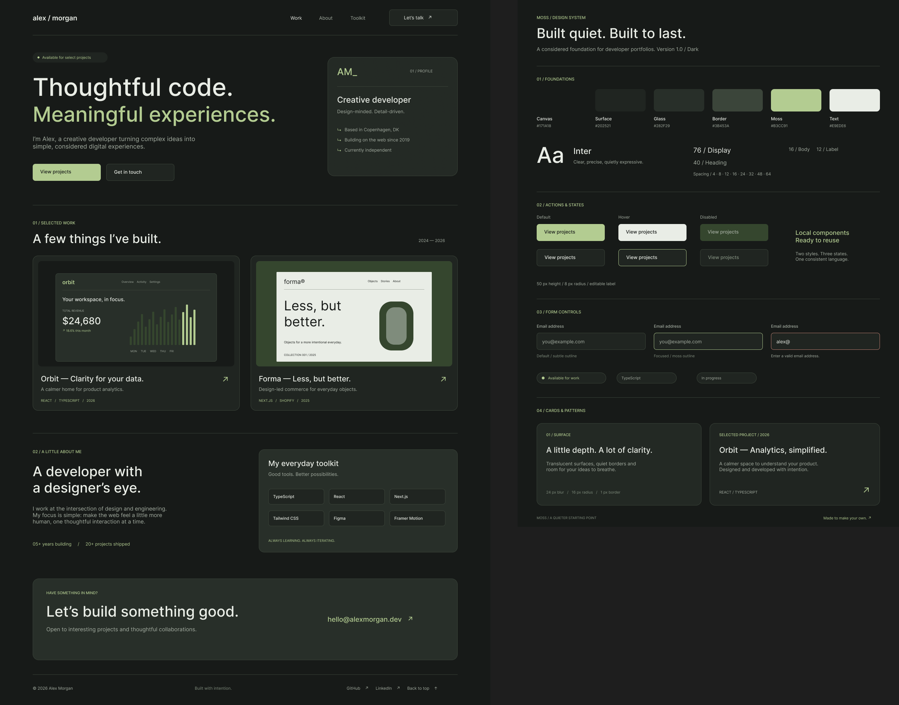

# Portfolio Web | Gervasio Ernst

🌐 **Enlace de Despliegue (GitHub Pages):** [https://gervasio-ernst.github.io/Portfolios/](https://gervasio-ernst.github.io/Portfolios/)

---

## 🛠️ Proceso de Desarrollo y Evolución del Proyecto

El desarrollo del portfolio se llevó a cabo de manera incremental mediante control de versiones en Git, estructurándose en las siguientes etapas:

### 1. Arquitectura y Estructura Modular (`HTML5`)
* Se diseñó un marcado semántico y accesible, organizado en secciones clave: Header de navegación fija con menú adaptable para dispositivos móviles, sección **Hero** con llamados a la acción, métricas o *Highlights*, grilla de habilidades tecnológicas, sección de proyectos destacados, trayectoria académica, biografía y canales de contacto directo (`mailto:` y redes).

### 2. Estilos y Arquitectura CSS Modular
* Con el objetivo de mantener un código limpio y mantenible, se estructuró la hoja de estilos de forma modular (dividiendo componentes independientes como `hero.css`, `header.css`, `projects.css`, `about.css`, `skills.css`, entre otros, además de un archivo de variables globales).
* **Línea estética (Glassmorphism & iOS style):** Se implementó una interfaz de modo oscuro con fondos oscuros profundos, tarjetas translúcidas con efectos de desenfoque (`backdrop-filter`) y sutiles acentos en verde esmeralda, logrando una estética moderna y profesional.

### 3. Interactividad y Canvas Global de Nodos (`JavaScript`)
* Se desarrolló un script en JavaScript vanilla que integra un elemento `<canvas>` posicionado como fondo global de la página (`fixed`). Este script genera dinámicamente un sistema de partículas o nodos flotantes interconectados en tiempo real que reaccionan con líneas sutiles al aproximarse, aportando dinamismo visual sin afectar el rendimiento de navegación.

### 4. Control de Versiones e Historial de Commits
* El repositorio fue inicializado y actualizado de forma incremental en GitHub, documentando paso a paso la evolución de la maquetación, la incorporación de componentes interactivos y la configuración final para su despliegue en producción mediante **GitHub Pages**.

---

## 📊 Auditoría de Rendimiento (Lighthouse)

El sitio web ha sido optimizado para garantizar una experiencia de usuario fluida, accesible y de alta performance tanto en computadoras como en dispositivos móviles.

### 💻 Versión Desktop

### 📱 Versión Móvil

---

## 🎨 Sistema de Diseño (Figma)

---

## 💻 Stack Tecnológico
* **Frontend:** HTML5, CSS3, JavaScript (Vanilla).
* **Diseño & UX:** Figma
* **Control de Versiones:** Git & GitHub.
* **Despliegue:** GitHub Pages.